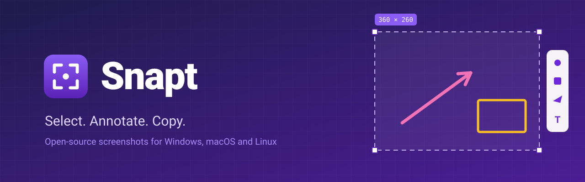

<div align="center">



**A fast, lightweight, open-source screenshot tool for Windows, macOS and Linux.**

Press PrtSc, select an area, add an arrow or a caption, then copy it or save it.<br>
No accounts, no cloud, a few megabytes on disk.

**[Website](https://vkardin.github.io/snapt/) ([RU](https://vkardin.github.io/snapt/ru/), [UA](https://vkardin.github.io/snapt/uk/)) · [Download](https://vkardin.github.io/snapt/#download) · [Report a bug](https://github.com/vkardin/snapt/issues)**

[](https://github.com/vkardin/snapt/actions/workflows/ci.yml)
[](LICENSE)

[](https://github.com/vkardin/snapt/releases)
[](https://github.com/vkardin/snapt/releases)


</div>

## Why Snapt

- **Fast.** A native Rust binary that starts instantly and sits idle in the tray.
- **Light.** No Electron, no web view, no runtime to install.
- **Private.** Shots stay on your machine. Snapt never uploads anything.
- **Familiar.** If you have used LightShot, you already know how Snapt works.

## Features

- Select an area on any monitor, HiDPI aware, with handles to move and resize it.
- Draw on it: pen, line, arrow, rectangle, marker and text, in any color, or one picked
  from the screen with the eyedropper.
- Copy the text in the selection, recognized by the system's own OCR (English, Russian,
  Ukrainian and more).
- Copy it, save it as PNG or JPEG, print it, or search Google Lens for similar images.
- A settings window for the capture shortcut, screenshots folder, image format and start at
  login, and an option to replace the system screenshot tool.
- In English, Russian and Ukrainian, and it updates itself from GitHub Releases.

Planned: Flatpak and code-signed installers.

## Install

Download the installer for your system from the
[website](https://vkardin.github.io/snapt/#download) or the
[latest release](https://github.com/vkardin/snapt/releases):
`.exe` or `.msi` for Windows, `.dmg` for macOS, `.deb` or AppImage for Linux.

Snapt is not code-signed yet. On Windows, click **More info → Run anyway** in the
SmartScreen prompt. On macOS, open **System Settings → Privacy & Security** after the
first launch attempt and click **Open Anyway**.

## Usage

Press **PrtSc** (**Cmd+Shift+9** on macOS) or pick **Take screenshot** in the tray menu.
The screen freezes, then:

| Action | How |
| --- | --- |
| Select an area | Drag with the left mouse button |
| Move or resize it | Drag inside the selection or by its handles |
| Select the whole screen | `Ctrl+A` |
| Pick a drawing tool | Click it in the panel, or press `P` pen, `L` line, `A` arrow, `R` rectangle, `M` marker, `T` text |
| Straight lines, squares | Hold `Shift` while drawing |
| Line width, text size | Mouse wheel |
| Undo, redo | `Ctrl+Z`, `Ctrl+Y` or `Ctrl+Shift+Z` |
| Copy to clipboard | `Ctrl+C`, `Enter` or double-click the selection |
| Save to a file | `Ctrl+S` |
| Print | `Ctrl+P` |
| Search for similar images | `Ctrl+F` |
| Copy the text in it | `Ctrl+Shift+C` |
| Pick a color from the screen | `I`, then click; the HEX code is copied too |
| Cancel | `Esc` or right-click |

On macOS, use `Cmd` instead of `Ctrl`. While typing text, `Enter` starts a new line and
`Esc` finishes the text.

### Settings

Pick **Settings…** in the tray menu. There you can:

- switch the language: English, Russian or Ukrainian (it follows the system by default);
- record a new capture shortcut by clicking the field and pressing the keys; Snapt tells you
  when another app already uses them;
- let Snapt replace the system screenshot tool: on Windows, PrtSc stops opening the Snipping
  Tool; on GNOME, the shortcut opens Snapt instead of GNOME Screenshot, on Wayland too; on
  macOS and other desktops, the window explains the one manual step;
- choose the screenshots folder and format, save without a dialog, and start at login;
- keep Snapt up to date: it checks GitHub Releases once a day and offers **Update** in the
  tray and in the window. The Windows installer, the macOS app and the AppImage update
  themselves; for the `.deb`, the download page opens.

The settings are stored in a plain-text `settings.ini` in the config folder.

### Command line

`snapt --capture` takes a screenshot right away and `snapt --settings` opens the settings.
If Snapt is already running, that copy does it, so the command can be bound to a key in the
system settings, for example on Wayland desktops without a global shortcuts portal.

`snapt --logs` opens the folder with the log of the last run (`snapt.log`) and a
`crash-<time>.txt` report for each crash. Attach them to a bug report.

## Building from source

You need a recent stable [Rust toolchain](https://rustup.rs).

```sh
git clone https://github.com/vkardin/snapt
cd snapt
cargo run --release
```

On Debian or Ubuntu, install the system libraries first:

```sh
sudo apt install libxcb1-dev libxcb-randr0-dev libxcb-shm0-dev libdbus-1-dev \
  libpipewire-0.3-dev libwayland-dev libegl-dev libgbm-dev clang
```

Set `RUST_LOG=debug` to see detailed logs.

To build the installers for your platform, install
[cargo-packager](https://github.com/crabnebula-dev/cargo-packager) and run:

```sh
cargo install cargo-packager --locked
cargo build --release
cargo packager --release
```

They land in `target/packages`. Pushing a `v*` tag builds them for all platforms in CI
and publishes a GitHub Release.

## Platform notes

- **macOS:** the first capture asks for the Screen Recording permission in
  System Settings → Privacy & Security. Restart Snapt after allowing it.
- **Linux:** the tray icon uses the StatusNotifierItem protocol. KDE supports it out of
  the box; on GNOME, install the AppIndicator extension. Text recognition uses Tesseract:
  `sudo apt install tesseract-ocr tesseract-ocr-rus tesseract-ocr-ukr`.
- **Wayland:** Snapt takes screenshots and gets its shortcut through the desktop portal
  (xdg-desktop-portal). The first time, the desktop may ask you to allow screenshots and
  to confirm the shortcut; you can change the key later in the desktop's keyboard
  settings. Global shortcuts need a portal that has them, such as KDE Plasma 6 or
  GNOME 48 and later. Elsewhere, bind `snapt --capture` to a key in the keyboard settings.
- **Windows:** text recognition works for the languages added in Settings → Time & language
  that include it.

## Contributing

Bug reports and ideas are welcome in [Issues](https://github.com/vkardin/snapt/issues).
See [CONTRIBUTING.md](CONTRIBUTING.md) for how to build, test and send a pull request.

## Support

Snapt is free and has no ads. If it saves you time, you can support development with crypto on the
[website](https://vkardin.github.io/snapt/#donate).

## License

[MIT](LICENSE) © vkardin

Snapt bundles a subset of the [Inter](https://github.com/rsms/inter) typeface,
licensed under the [SIL Open Font License](assets/fonts/OFL.txt).
